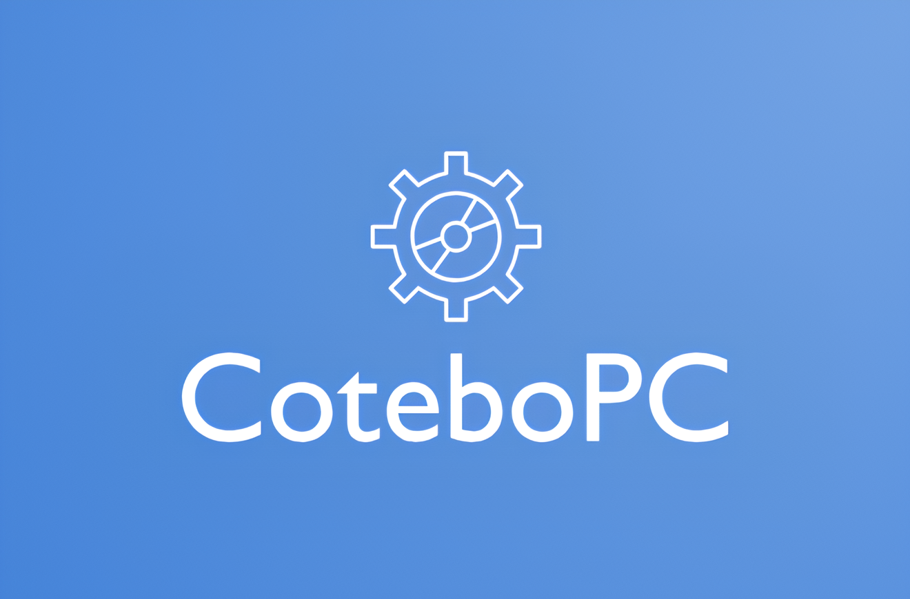

# CoteboPC

Приложение для удаленного управления ПК через Telegram-бота, работающее на Linux (Fedora).

## Инструкция по запуску на Fedora Linux

### 1. Установка .NET SDK
Проект использует **.NET 10.0**. Установите SDK:
```bash
sudo dnf install dotnet-sdk-10.0
```
*Если версия 10.0 недоступна в репозиториях, используйте официальный скрипт установки Microsoft или измените TargetFramework в `.csproj` на `net8.0`.*

### 2. Установка зависимостей для Avalonia и утилит
Для работы графического интерфейса и функций (скриншоты, управление окнами) необходимы библиотеки и утилиты:
```bash
sudo dnf install libX11 libICE libSM freetype fontconfig xdotool scrot
```
*Примечание: `libSkiaSharp` обычно устанавливается автоматически с NuGet-пакетом, но системные библиотеки (libX11 и др.) обязательны.*

### 3. Сборка проекта
Перейдите в папку с проектом и выполните:
```bash
cd CoteboPC
dotnet build
```

### 4. Запуск
После сборки запустите исполняемый файл:
```bash
dotnet run --project CoteboPC.csproj
```
Или запустите скомпилированный файл напрямую:
```bash
./bin/Debug/net10.0/linux-x64/CoteboPC
```

### 5. Автозапуск (Systemd)
Для настройки автозапуска через systemd (функция в приложении) убедитесь, что у вас активирована поддержка user-сервисов:
```bash
systemctl --user enable cotebopc.service
systemctl --user start cotebopc.service
```

## Примечания
- Приложение использует скрытое окно для работы в фоне.
- Для скриншотов и системной информации требуются соответствующие права доступа.
- Трей (NotifyIcon) отключен на Linux для обеспечения совместимости.

